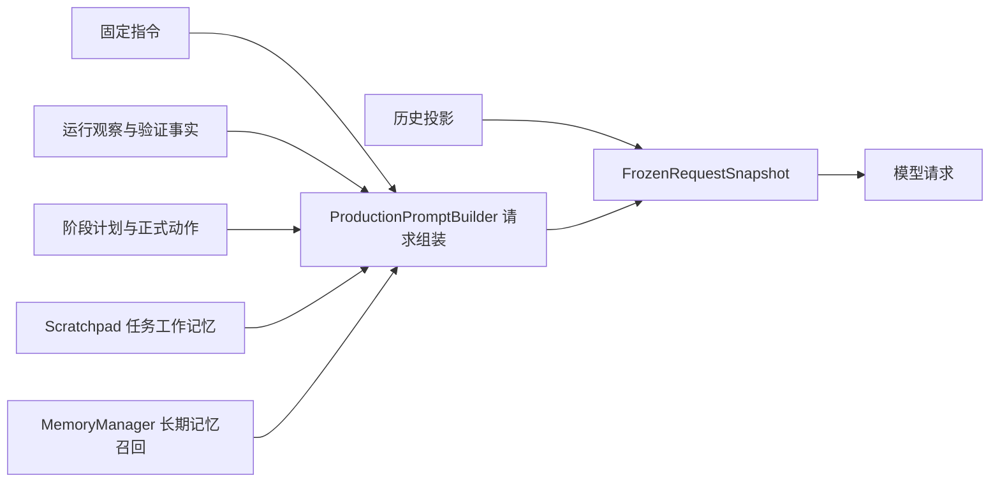

大模块	负责什么	包含的小模块
1. 用户交互与服务入口	接收需求，把执行过程和结果展示给用户	终端交互、无界面命令行、Python 调用接口、HTTP 服务、流式展示、权限弹窗、用户提问、停止与追加消息
2. 任务执行与规划	决定当前任务如何推进，并驱动执行循环	需求合同、任务规划、调查到实施的动作交接、重新规划、模型与工具循环、轮数预算、停滞处理、运行生命周期
3. 模型接入与调用管理	统一调用不同模型，处理调用结果	服务商适配、模型能力配置、请求预检、流式与普通响应、工具调用解析、错误分类、重试、超时取消、用量与费用归集
4. 上下文与记忆	组织模型每次能看到的信息，保留长任务线索	系统提示组装、动态上下文组装（读取已有状态与记忆）、历史投影、输入预算、旧工具结果清理、结构化压缩摘要、任务工作记忆、长期记忆召回、图片与文档预处理
5. 工具执行平台	把模型提出的操作变成实际执行，并返回结果	工具注册与发现、参数校验、权限审批、读写文件、编辑事务、命令执行、后台进程、并行工具调度、取消、输出与错误归一化、外部工具接入
6. 代码库理解与检索	帮助 Agent 找到相关代码、理解影响范围	文本搜索、代码索引、仓库地图、语法分析、符号与依赖关系、语言服务、可选语义检索、项目画像、变更影响分析、调查材料组装
7. 多 Agent 协作与工作区管理	分配子任务，让多个 Agent 协作开发	子 Agent 创建与恢复、后台调度、邮箱通信与等待、线程/进程执行、任务取消与结算、工作树隔离、父工作区同步、依赖复用、环境准备、结果收集与应用、工作流编排
8. 验证与交付控制	判断做了什么、验证了什么、是否满足交付条件	独立验证域、验收要求、检查定义、执行事实、代码版本与证据关联、验证调度、失败复测、交付评审、完成判定、未验证状态说明
9. 会话、持久化与恢复	保存运行过程，使任务能够恢复和审查	会话与消息身份、消息分段、检查点、运行状态落盘、会话分支与回退、工作区快照、变更记录、事件流、轨迹日志、运行证据
10. 评测与实验	衡量 Agent 能力，复现框架问题	SWE-bench 评测、项目自主开发测试、核心能力测试、并行与恢复测试、终端产品测试、模型调用转发与预算控制、轨迹分析、对照实验

主要代码对应如下：
模块	主要代码位置
交互入口	interface/、http_service/、[sdk.py](/home/pyh/nzcoder/nz_coder/sdk.py)
任务执行	runtime/execution/、runtime/agent/，核心是 [runner.py](/home/pyh/nzcoder/nz_coder/runtime/execution/runner.py)
模型调用	providers/、[runtime/model_gateway/](/home/pyh/nzcoder/nz_coder/runtime/model_gateway/gateway.py)
上下文与记忆	runtime/conversation/、state/context.py、state/memory.py、tools/scratchpad.py
工具平台	tools/、tool_platform/、runtime/tool_runtime/、runtime/process/
代码库理解	intelligence/、lsp/、仓库检索类工具
多 Agent	runtime/agent/、runtime/worktree/、runtime/workflows/
验证交付	runtime/verification/，状态核心是 [VerificationDomain (line 17)](/home/pyh/nzcoder/nz_coder/runtime/verification/domain/service.py:17)
会话恢复	runtime/session/、state/、protocol/
评测实验	evaluation/、swebench/、tests/

## 上下文与记忆的层级和归属

这一模块包含两个层次：**组装机制**决定本次请求怎样呈现信息，**信息来源**保存各自负责的内容。任务工作记忆是动态上下文读取的来源之一；动态注入本身不另建一份任务状态。运行事实、验收事实和计划的维护仍属于任务执行、验证交付等原模块。

| 信息 | 实际维护者 | 上下文中的用途与边界 |
| --- | --- | --- |
| 用户要求和验收定义 | 宿主根据真实用户消息提交合同；存在验证域时，由域声明并回读归一化定义到 RuntimeState | 提供当前约束；模型笔记或计划不能另改一份要求 |
| 执行轮数、预算和调查观察 | 现有 RunContext / RuntimeState 运行字段 | 提供运行情况和提示；这些观察不等同于验收结论 |
| 检查结果、需求满足情况和验证代次 | VerificationDomain；RuntimeState 中相关字段由域快照投影 | 表示当前代码实际验证情况；旧测试记录不能自动证明当前版本通过 |
| 阶段路线 | RuntimeState.plan_text | 作为工作计划建议展示，不维护另一份验收完成表 |
| 已接受的正式当前动作 | 既有 execution_handoff 及来源、版本和状态校验 | 按原交接流程维护；修改计划或笔记不会自动替换动作 |
| 本次任务的调查发现、假设、决策理由和失败经验 | Scratchpad 的 focus / findings / decisions / lessons 四区 | 自动展示简短结论，需要时回读完整依据；confirmed 是模型标签，不是验证凭证 |
| 跨会话的用户偏好、项目知识与经验 | MemoryManager 与项目作用域内唯一的 SQLiteMemoryStore | 按 ID 和版本保存，明确维护条件、来源及核查判断；受控子工作树共享项目记忆，文件核对仍针对自己的源码目录 |
| 本次请求的层次、顺序和预算 | ProductionPromptBuilder 与 FrozenRequestSnapshot | 读取、组织和投影上述来源，不独立维护业务事实 |

例如：“当前集成测试失败，退出码为 1”属于执行与验证事实；“该集成测试需要先启动数据库，依据是初始化代码和连接错误，适用于这组集成用例”可以保存为调查笔记。前者随实际执行和代码版本更新，后者保留发现的原因、依据与条件。

动态块通过 `FrozenRequestSnapshot.project` 加入本次请求末尾，不写回原会话历史。组装沿用已有的动作新鲜度核验和提醒观察计数，不能把全链描述为完全无副作用的纯读取。

检查点、历史摘要和工具历史可以引用同一来源。比如更新笔记的原始工具入参仍保留在历史中，当前笔记摘要也会进入本次动态块；这些是不同用途的记录，不是两个可独立维护的当前状态。不得按关键词或全请求文本重复自动删掉它们。模型仍可能写出语义重复或过时的笔记，目前的结构与指导不保证自动语义去重。

主要入口：[请求组装](nz_coder/runtime/conversation/prompt_builder.py)、[冻结与投影](nz_coder/runtime/conversation/request_snapshot.py)、[当前事实投影](nz_coder/runtime/conversation/continuation_context.py)、[任务工作记忆](nz_coder/tools/scratchpad.py)、[长期记忆](nz_coder/state/memory.py)。本轮方案和审核结论见[实施记录](docs/evidence/context-memory-boundary-2026-11-09/final-report.md)。

### 长期记忆的保存、召回与维护

长期记忆由模型显式保存和维护。`MemoryManager` 是工具、命令行和 HTTP 的共同门面，`SQLiteMemoryStore` 保存唯一的当前记录、不可变版本、提案、核查事件与操作收据。全文索引在同一事务中更新；可选的本地向量只是可重建的派生数据，不能覆盖正文。Markdown 用于显式迁移和导出，不再承担生产写入。

每条记忆有稳定 ID 和修订号。更新、归档、恢复与删除必须指出读到的版本；版本冲突先返回当前版本，不能静默覆盖。核查结论由模型写出，可以是支持、矛盾或无法判断，并说明检查了全部还是部分内容。相反结论保留为事件，只有明确指明解决哪些旧事件时才撤回，不能根据时间新旧替模型判断真假。

模型每次请求只收到有条件和警示的少量背景索引。缓存包含数据库持久代次，其他会话修改后，下一次请求重新取索引；已冻结的请求保持自己的原快照。自动注入不会读取源码或执行检查。明确要求核对来源时，才在当前工作区权限、取消状态、期限和读取预算内比较文件身份；文件相同仅说明来源未变，不能证明其中的推断正确。

主 Agent 创建的子任务继承逻辑记忆作用域，同时保留各自源码目录。只读子任务只能读取；可写子任务的长期记忆变更先进入提案，父方接受后才发布。会话保存作用域与能力，恢复不能静默换库。会话回退也不会把长期记忆库回滚成旧快照。

默认使用中文和英文全文检索，不需要额外模型。显式配置已有本地模型并重建索引后，可使用词面与语义混合召回；缺少模型、编码器失败或索引不适用时会显示降级状态并保留词面能力，不自动安装或下载。已移除会话结束后自动提取、相似度合并和按年龄删除，不让这些规则代替模型维护内容。

实现：[存储](nz_coder/state/memory_store.py)、[来源核对与检索](nz_coder/state/memory_retrieval.py)、[作用域](nz_coder/state/memory_scope.py)、[迁移](nz_coder/state/memory_migration.py)。验证与三方代码审查见[长期记忆实施报告](docs/evidence/longterm-memory-implementation-2026-11-09/final-report.md)。
